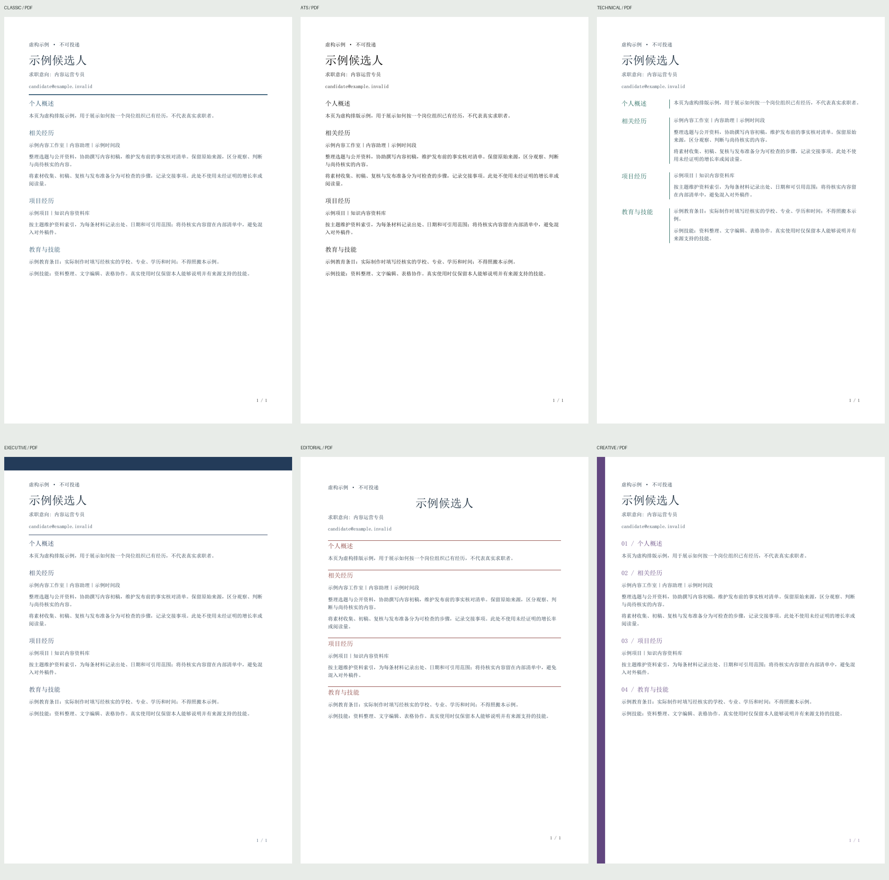

<p align="center">
  
</p>

<h1 align="center">Smart Resume</h1>

<p align="center"><b>A JD screenshot plus your existing materials into a truthful two-page A4 resume</b></p>

<p align="center">
   
</p>

<p align="center"><a href="README.md">简体中文</a> · <a href="README.zh-TW.md">繁體中文</a> · <a href="README.en.md">English</a></p>

---

<a id="what"></a>

## What this is

- Screenshot in, resume out: it reorders your real work around that one role
- Never invents: unverified work is asked about, the job title is copied verbatim
- Two deliverables: a submittable PDF and an editable web version

**Who it is for**: Anyone job hunting who needs one resume tailored to one role

### Use it after installation

Give your AI your old resume and the target JD (screenshot or text), then say:

> Use $smart-resume to update my resume for this JD. Read my existing materials,
> ask about missing facts one at a time, recommend a layout, use only supported
> experience, and deliver PDF plus editable HTML after reviewing every page.

The six styles are six layouts for the same supported content, not six career
directions. Ask the AI to recommend one, name a style or reuse a saved profile.
Everyday use does not require running the developer commands below.
The host AI reads screenshots, asks questions and tailors wording.

### What changed in 0.2.0

| Workflow | Previous version | Added in this update |
| --- | --- | --- |
| Layout | One fixed design | Six working PDF / HTML layouts |
| Template choice | Fixed default | Explainable role-keyword recommendations and explicit overrides |
| Preview | One demo | Six real PDF samples and a filterable offline gallery |
| Personal preferences | No separate style profile | Save and reuse base layout, accent and spacing |
| Quality | Source eligibility, overflow refusal and pending review records | Text completeness, hashes, A4, overlap checks and review acceptance |
| Documentation | Existing three-language READMEs | Installation/update, choice, saving and acceptance instructions |

The existing JD screenshot workflow, evidence-based selection and PDF/HTML export
remain. Matching is a keyword heuristic; profiles currently customize the colors
and spacing of an existing layout.



## Contents

- [What this is](#what)
- [How to install](#install)
- [See the finished output in 30 seconds](#demo)
- [How to use it](#usage)
- [What is inside](#structure)
- [What it does not do](#limits)
- [License](#license)


<a id="install"></a>

## How to install

<details open>
<summary><b>Easiest: send one line to your AI</b></summary>

Send this to an AI that supports installing skills and can access the repository and write files:

```text
Install or update Smart Resume Skill from https://github.com/menghaoran214-lang/smart-resume-skill. Check for an existing installation first, back it up before updating, preserve my private resume data and styles, then verify PDF generation.
```

Install or update from the existing repository; the invocation remains `$smart-resume`.
The AI needs repository access and an environment where skills can be installed.
An ordinary chat may not support installation. On a phone, use an AI connected
to a computer or cloud runtime; this is not a native iOS installation.

</details>

<details>
<summary><b>Or install it yourself (Windows, macOS and Linux)</b></summary>

<a id="install-manual"></a>

```text
git clone https://github.com/menghaoran214-lang/smart-resume-skill.git
cd smart-resume-skill
python3 -m pip install -r skills/smart-resume/requirements.txt
python3 skills/smart-resume/scripts/install.py --target ~/.codex/skills/smart-resume
```

Requires Git and Python 3.10+. On Windows use `py` or `python` instead of `python3`.
The target shown is for Codex; other agents need their own skill directory.
Use a separate virtual environment for dependencies.
Existing installations are never overwritten. Back up an old skill directory
before installing to the original target. Keep private candidate data and
`~/.smart-resume/styles/` separate; updating the skill does not require deleting them.

</details>

<a id="demo"></a>

## See the finished output in 30 seconds

After installing dependencies, run this from the repository root to preview
the layout with **fictional data**. It only generates files; it does not read a
screenshot or your personal materials.

```text
cd skills/smart-resume
python3 scripts/resume.py render examples/demo.json --demo --out output/demo
```

| File | What it is |
| --- | --- |
| `output/demo/resume.pdf` | Two A4 sample pages for preview only; do not submit |
| `output/demo/resume.html` | The same resume as a web page; click to edit |
| `output/demo/review.json` | Layout and fact review record for you or the AI to check |

The sample data is made up, every page says "fictional sample, do not submit",
and it cannot be mistaken for a real resume.

### Six styles that actually generate PDFs

| ID | Style | Selection cues |
| --- | --- | --- |
| `classic` | [Classic Business PDF](docs/previews/classic.pdf) | Finance, administration, legal |
| `ats` | [ATS Minimal PDF](docs/previews/ats.pdf) | Plain black single column; no universal ATS guarantee |
| `technical` | [Technical Ledger PDF](docs/previews/technical.pdf) | Engineering, software, data; left section labels |
| `executive` | [Executive Brief PDF](docs/previews/executive.pdf) | Management; dark top band |
| `editorial` | [Editorial Journal PDF](docs/previews/editorial.pdf) | Content, editing, communications; centered name and fine rules |
| `creative` | [Creative Portfolio PDF](docs/previews/creative.pdf) | Design, brand, visual roles; side rail and numbered sections |

Each has `styles/<id>/STYLE.md` with stable visual rules. Every layout preserves
the same approved content and 10.5 pt body. Gallery thumbnails are rendered from
the actual PDFs, include every page and link to both PDF and HTML.

Run inside the skill directory (`skills/smart-resume` in the engineering project,
or the extracted `smart-resume` directory in the installation archive):

```text
python scripts/gallery.py --input examples/demo.en.json --compact --out output/gallery
python scripts/resume.py match examples/demo.en.json
python scripts/resume.py render examples/demo.en.json --demo --style technical --out output/technical
python scripts/resume.py save-style my-green --base technical --accent "#155e52" --spacing airy
python scripts/resume.py render examples/demo.en.json --demo --profile ~/.smart-resume/styles/my-green/profile.json --out output/my-green
```

Open `output/gallery/index.html`. The gallery additionally requires Poppler's
`pdftoppm`; use `--pdftoppm` to specify its path. Missing tools produce an actionable
error. Simplified Chinese, Traditional Chinese and English fixtures are
`examples/demo.json`, `examples/demo.zh-TW.json` and `examples/demo.en.json`.

`--compact` combines all fictional sections into one page for comparison without
dropping text or reducing type size. Omit it to keep the input's original page
count. The gallery saves its exact `demo-input.json` for checking those PDFs.

Automatic matching uses keywords from the exact JD title and optional `--context`.
It prints reasons and falls back to classic when nothing matches. Explicit
`--style` or `--profile` takes priority. `--ats` requests plain output; contradictory
options fail. Scores are transparent rule counts, not hiring probabilities.

Personal styles are stored under `~/.smart-resume/styles/<name>/` as `profile.json`
and `STYLE.md`, containing preferences only, never candidate history. Choose a
different directory with `--profiles-dir`. Existing styles cannot be overwritten.
Accent contrast and spacing are validated before reuse.

### Quality acceptance

```text
python scripts/quality.py output/technical examples/demo.en.json --demo
```

Checks A4, page count, selected text, artifact hashes and layout bounds, then writes
`quality.json`. Initially returns incomplete: every PDF page, source facts and
HTML must actually be reviewed before recording reviewer and findings according
to the [style and acceptance guide](skills/smart-resume/references/styles.md).
Fictional examples can be accepted as previews, never as application-ready resumes.
Overflow fails without shrinking or hiding text. HTML and PDF have separate
renderers; edit JSON and regenerate both.

<a id="usage"></a>

## How to use it

After installing, say one sentence to your AI:

> Use $smart-resume to tailor my resume to this JD screenshot. Read the materials
> you are authorized to access, ask for my old resume first if that is not enough,
> then ask about the rest one item at a time. Use only the exact JD title.

The AI reads your materials, asks for what is missing, reorders the relevant
experience around that role, produces the PDF and editable version, and checks
every page. It does not invent experience and does not mix in another role.

<a id="structure"></a>

## What is inside

```text
smart-resume/
├── assets/
│   ├── intake.json
│   └── resume.html
├── examples/
│   ├── demo.en.json
│   ├── demo.json
│   └── demo.zh-TW.json
├── references/
│   ├── styles.md
│   └── workflow.md
├── scripts/
│   ├── gallery.py
│   ├── install.py
│   ├── package.py
│   ├── quality.py
│   ├── resume.py
│   └── styles.py
├── styles/
│   ├── ats/
│   │   └── STYLE.md
│   ├── classic/
│   │   └── STYLE.md
│   ├── creative/
│   │   └── STYLE.md
│   ├── editorial/
│   │   └── STYLE.md
│   ├── executive/
│   │   └── STYLE.md
│   ├── technical/
│   │   └── STYLE.md
│   └── catalog.json
├── tests/
│   ├── test_resume.py
│   └── test_styles.py
├── LICENSE
├── requirements.txt
├── SKILL.md
└── VERSION
```


<a id="limits"></a>

## What it does not do

- The skill lives in `skills/smart-resume/`. The scripts validate and typeset;
  reading the screenshot and picking the right experience is the host AI's job.
- The editable format is HTML. **There is no Word/DOCX export**; HTML edits do
  not update the PDF, so change the JSON and regenerate.
- Remembered experience needs your confirmation. Scripts can check that a source
  exists; they cannot judge whether it is true.
- It never submits applications or uploads anything; it asks before touching
  any external system.

<a id="license"></a>

## License

This project uses the [MIT License](LICENSE): use, modify and ship it
commercially; retain the copyright and permission notice when distributing copies.
The style-specification and gallery mechanism is inspired by
[Lemo-Opuscar](https://github.com/lemomo-ai/lemo-opuscar). These six resume layouts
are original implementations and do not require its video runtime.
