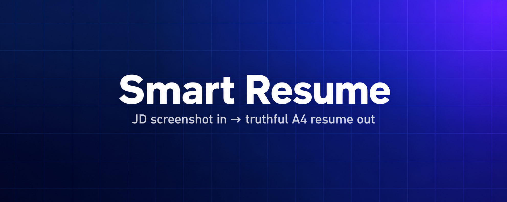

<p align="center">
  
</p>

<h1 align="center">Smart Resume</h1>

<p align="center"><b>A JD screenshot plus your existing materials into a truthful two-page A4 resume</b></p>

<p align="center">
   
</p>

<p align="center"><a href="README.md">简体中文</a> · <a href="README.zh-TW.md">繁體中文</a> · <a href="README.en.md">English</a></p>

---

<a id="what"></a>

## What this is

- Screenshot in, resume out: it reorders your real work around that one role
- Never invents: unverified work is asked about, the job title is copied verbatim
- Two deliverables: a submittable PDF and an editable web version

**Who it is for**: Anyone job hunting who needs one resume tailored to one role

## Contents

- [What this is](#what)
- [How to install](#install)

  <details>
  <summary>Installation options (expand)</summary>

  - [Ask your AI to install](#install-ai)
  - [Manual installation](#install-manual)

  </details>

- [See the finished output in 30 seconds](#demo)
- [How you use it](#usage)
- [What is inside](#structure)
- [What it does not do](#limits)
- [License](#license)


<a id="install"></a>

## How to install

<a id="install-ai"></a>

### Easiest: send one line to your AI

Send this to an AI that supports installing skills and can access the repository and write files:

```text
Install this skill: https://github.com/menghaoran214-lang/smart-resume-skill
```

The AI needs repository access and an environment where skills can be installed.
An ordinary chat may not support installation. On a phone, use an AI connected
to a computer or cloud runtime; this is not a native iOS installation.

<a id="install-manual"></a>

### Or install it yourself (Windows, macOS and Linux)

```text
git clone https://github.com/menghaoran214-lang/smart-resume-skill.git
cd smart-resume-skill
python3 -m pip install -r skills/smart-resume/requirements.txt
python3 skills/smart-resume/scripts/install.py --target ~/.codex/skills/smart-resume
```

Requires Git and Python 3.10+. On Windows use `py` or `python` instead of `python3`.
The target shown is for Codex; other agents need their own skill directory.
Use a separate virtual environment for dependencies.

<a id="demo"></a>

## See the finished output in 30 seconds

After installing dependencies, run this from the repository root to preview
the layout with **fictional data**. It only generates files; it does not read a
screenshot or your personal materials.

```text
cd skills/smart-resume && python3 scripts/resume.py render examples/demo.json --demo --out output/demo
```

| File | What it is |
| --- | --- |
| `output/demo/resume.pdf` | Two A4 sample pages for preview only; do not submit |
| `output/demo/resume.html` | The same resume as a web page; click to edit |
| `output/demo/review.json` | Layout and fact review record for you or the AI to check |

The sample data is made up, every page says "fictional sample, do not submit",
and it cannot be mistaken for a real resume.

<a id="usage"></a>

## How you use it

After installing, say one sentence to your AI:

> Use $smart-resume to tailor my resume to this JD screenshot. Read the materials
> you are authorized to access, ask for my old resume first if that is not enough,
> then ask about the rest one item at a time. Use only the exact JD title.

The AI reads your materials, asks for what is missing, reorders the relevant
experience around that role, produces the PDF and editable version, and checks
every page. It does not invent experience and does not mix in another role.

<a id="structure"></a>

## What is inside

```text
smart-resume/
├── assets/
│   ├── intake.json
│   └── resume.html
├── examples/
│   └── demo.json
├── references/
│   └── workflow.md
├── scripts/
│   ├── install.py
│   ├── package.py
│   └── resume.py
├── tests/
│   └── test_resume.py
├── LICENSE
├── requirements.txt
├── SKILL.md
└── VERSION
```


<a id="limits"></a>

## What it does not do

- The skill lives in `skills/smart-resume/`. The scripts validate and typeset;
  reading the screenshot and picking the right experience is the host AI's job.
- The editable format is HTML. **There is no Word/DOCX export**; HTML edits do
  not update the PDF, so change the JSON and regenerate.
- Remembered experience needs your confirmation. Scripts can check that a source
  exists; they cannot judge whether it is true.
- It never submits applications or uploads anything; it asks before touching
  any external system.

<a id="license"></a>

## License

[0BSD](LICENSE) · Use, modify and use commercially; provided as is, without warranty.
