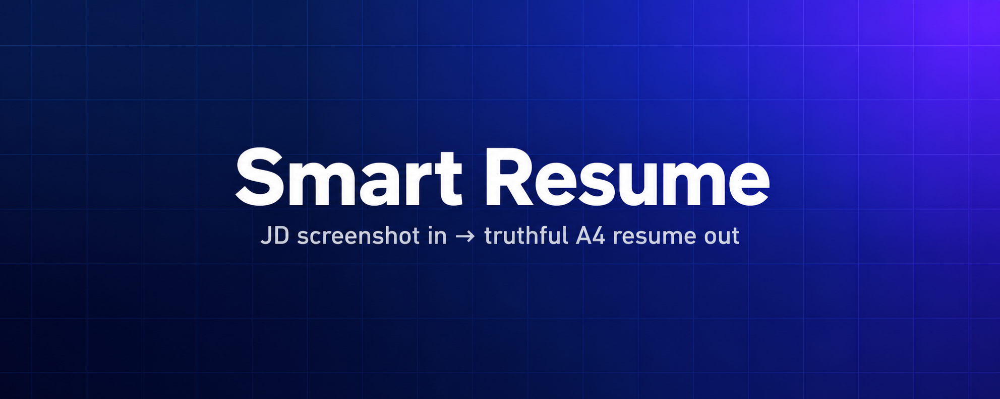

[简体中文](README.md) · [繁體中文](README.zh-TW.md) · [English](README.en.md)

<p align="center">
  
</p>

   

<p align="center"><b>一张 JD 截图 + 你已有的资料 → 一份不编造的两页 A4 简历</b></p>

- 岗位截图进，简历出：截图交给它，它照着这个岗位重排你做过的事
- 不编造：没做过的不写，记不清的先问你，岗位名照抄截图
- 交付两件：可投的 PDF 和能直接改字的网页版

**适合谁用**：正在投简历、想针对某个岗位改一版的人

---

## 安装

```text
python -m venv .venv
pip install -r skills/smart-resume/requirements.txt
python skills/smart-resume/scripts/install.py --target ~/.codex/skills/smart-resume
```

Windows 用 `.\.venv\Scripts\python.exe` 替换 `python`。安装器不覆盖已有目录，
依赖请装在自己的虚拟环境里，不会改动 Agent 的运行环境。

## 30 秒看效果

```text
cd skills/smart-resume && python scripts/resume.py render examples/demo.json --demo --out output/demo
```

会生成 `resume.pdf`（两页 A4）、`resume.html`（可编辑）和 `review.json`（验收记录）。
示例数据完全是虚构的，每页都标注不可投递。

## 它怎么用

装好后对 Agent 说一句话就行：

> 用 $smart-resume 按这张 JD 截图做定制简历。先读我授权范围内的资料，
> 不够先问我要旧简历，其他缺项逐项问。求职意向只用截图里的岗位名。

Agent 会：读你的资料 → 缺什么问你 → 挑相关经历重排 → 出 PDF + 可编辑版 → 逐页验排版。
它不会编造经历，也不会把别的岗位混进来。

## 目录

- [安装](#安装)
- [30 秒看效果](#30-秒看效果)
- [它怎么用](#它怎么用)
- [目录结构](#目录结构)
- [边界与限制](#边界与限制)
- [仓库状态](#仓库状态)
- [参与](#参与)


## 目录结构

```text
smart-resume/
│   ├── intake.json
│   ├── resume.html
│   ├── demo.json
├── LICENSE
│   ├── workflow.md
├── requirements.txt
│   ├── install.py
│   ├── package.py
│   ├── resume.py
├── SKILL.md
│   ├── test_resume.py
├── VERSION
```


## 边界与限制

- 技能本体在 `skills/smart-resume/`，脚本只做校验和排版，识别截图和定制内容由宿主 Agent 完成。
- 可编辑版是 HTML，**不提供 DOCX**；HTML 改动不会自动同步 PDF，改 JSON 后重新生成。
- 记忆里的经历需要你确认；脚本只能检查"有没有来源"，判断不了真假。
- 不会替你投简历、不会公开上传，需要你授权才会动外部系统。

## 仓库状态

<p align="center">
  
</p>

- 技能版本 / skill version：`0.1.0`
- 上方统计图由定时工作流自动刷新；CI 状态见仓库顶部 Actions 徽章


README 由 `scripts/render_readme.py` 从 `templates/` 与 `data/project.json` 生成，
改内容请改模板或数据后重新生成。

## 参与

见 [CONTRIBUTING.md](CONTRIBUTING.md) 与 [AGENTS.md](AGENTS.md)，
变更记录见 [CHANGELOG.md](CHANGELOG.md)，许可证见 [LICENSE](LICENSE)。
