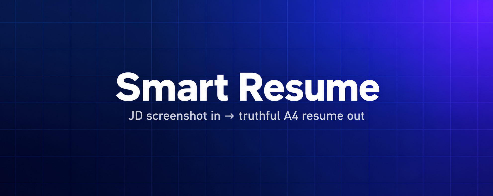

<p align="center">
  
</p>

<h1 align="center">Smart Resume</h1>

<p align="center"><b>一張 JD 截圖 + 你既有的資料 → 一份不捏造的兩頁 A4 履歷</b></p>

<p align="center">
   
</p>

<p align="center">[简体中文](README.md) · [繁體中文](README.zh-TW.md) · [English](README.en.md)</p>

---

## 這是什麼

- 職缺截圖進，履歷出：截圖交給它，它照著這個職缺重排你做過的事
- 不捏造：沒做過的不寫，記不清的先問你，職缺名照抄截圖
- 交付兩件：可投的 PDF 和能直接改字的網頁版

**適合誰用**：正在投履歷、想針對某個職缺改一版的人

## 目錄

- [這是什麼](#這是什麼)
- [怎麼安裝](#怎麼安裝)
  - [最省事：把這一行傳給你的 AI](#最省事把這一行傳給你的-ai)
  - [或者自己裝（Windows、macOS、Linux 都一樣）](#或者自己裝windowsmacoslinux-都一樣)
- [30 秒看成品](#30-秒看成品)
- [實際怎麼用](#實際怎麼用)
- [這個技能長什麼樣](#這個技能長什麼樣)
- [它不做什麼](#它不做什麼)
- [倉庫狀態](#倉庫狀態)
- [開源授權](#開源授權)


## 怎麼安裝

### 最省事：把這一行傳給你的 AI

複製下面這行，貼到 Codex / Claude Code / 任何支援 Skill 的 AI 對話框，它會自己去抓取並安裝：

```text
請安裝這個技能：https://github.com/menghaoran214-lang/smart-resume-skill
```

### 或者自己裝（Windows、macOS、Linux 都一樣）

```text
git clone https://github.com/menghaoran214-lang/smart-resume-skill.git
cd smart-resume-skill
python3 -m pip install -r skills/smart-resume/requirements.txt
python3 skills/smart-resume/scripts/install.py --target ~/.codex/skills/smart-resume
```

Windows 把 `python3` 換成 `py` 或 `python`。手機沒有本地終端機，但可以把上面那行口令傳給雲端 AI 幫你裝。

## 30 秒看成品

這條命令會用倉庫裡的**虛構範例**跑一遍完整流程，產生三個檔案：

```text
cd skills/smart-resume && python3 scripts/resume.py render examples/demo.json --demo --out output/demo
```

| 檔案 | 是什麼 |
| --- | --- |
| `output/demo/resume.pdf` | 兩頁 A4 履歷，文字可選取複製，直接能投 |
| `output/demo/resume.html` | 同一份履歷的網頁版，點一下就能改字 |
| `output/demo/review.json` | 排版與事實的檢查記錄，交給你或 AI 複核 |

範例資料全是編的，每頁都寫著「虛構範例 · 不可投遞」，不會被誤認成真實履歷。

## 實際怎麼用

裝好後對 AI 說一句話就行：

> 用 $smart-resume 依這張 JD 截圖製作履歷。先讀我授權範圍內的資料，
> 不夠先跟我要舊履歷，其他缺項逐項問。求職意向只用截圖裡的職缺名。

AI 會：讀你的資料 → 缺什麼問你 → 挑相關經歷重排 → 出 PDF 加可編輯版 → 逐頁驗排版。
它不會捏造經歷，也不會混入其他職缺。

## 這個技能長什麼樣

```text
smart-resume/
├── assets/
│   ├── intake.json
│   └── resume.html
├── examples/
│   └── demo.json
├── references/
│   └── workflow.md
├── scripts/
│   ├── install.py
│   ├── package.py
│   └── resume.py
├── tests/
│   └── test_resume.py
├── LICENSE
├── requirements.txt
├── SKILL.md
└── VERSION
```


## 它不做什麼

- 技能本體在 `skills/smart-resume/`，腳本只做檢查與排版；辨識截圖、挑經歷是宿主 AI 的活。
- 可編輯版為 HTML，**不提供 Word/DOCX**；改 HTML 不會同步 PDF，改 JSON 後重新產生。
- 記憶中的經歷需你確認；腳本只能檢查「有沒有來源」，判斷不了真偽。
- 不會替你投遞、不會公開上傳任何東西，動外部系統前一定問你。

## 倉庫狀態

<p align="center">
  
</p>

- 技能版本 / skill version：`0.1.0`
- 上方统计图由定时工作流自动刷新；CI 状态见仓库顶部 Actions 徽章


README 由 `scripts/render_readme.py` 依 `templates/` 與 `data/project.json` 產生，
改內容請改模板或資料後重新產生。

## 開源授權

本專案採用 **0BSD** 授權（見 [LICENSE](LICENSE)）：你可以自由使用、修改、再散布，
包括商用，不需要署名。想提改進建議或程式，看 [CONTRIBUTING.md](CONTRIBUTING.md)；
那份文件是給「想參與開發的人」看的，只是想用它做履歷就不必打開。
每次改動記錄在 [CHANGELOG.md](CHANGELOG.md)。
